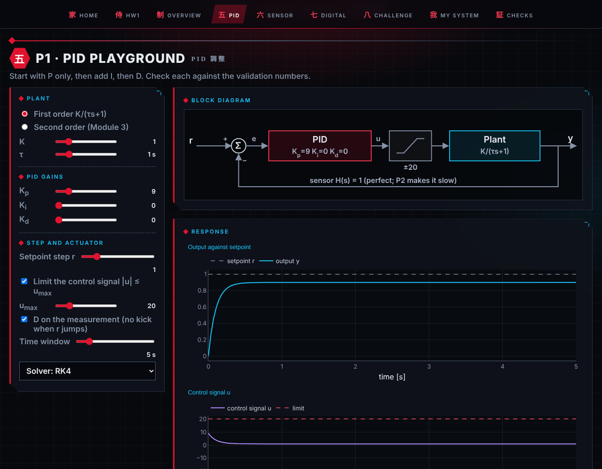
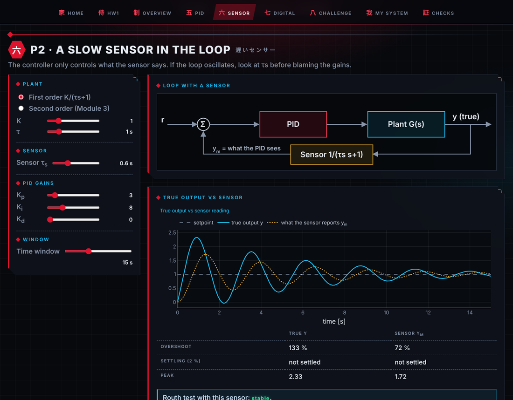
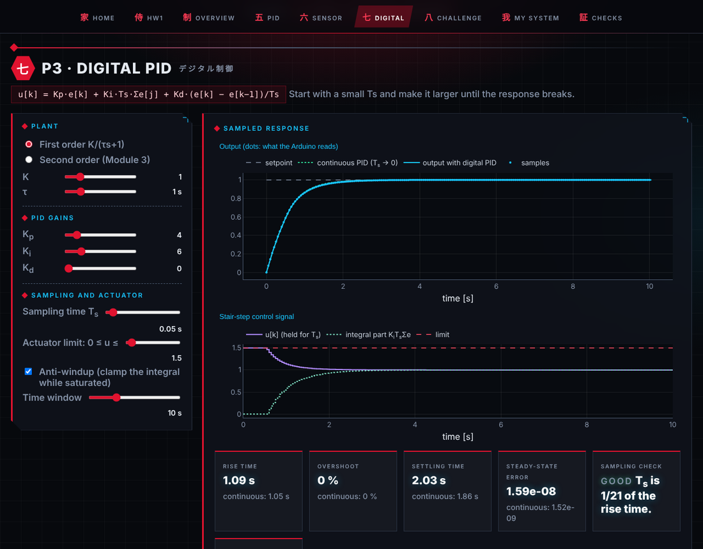
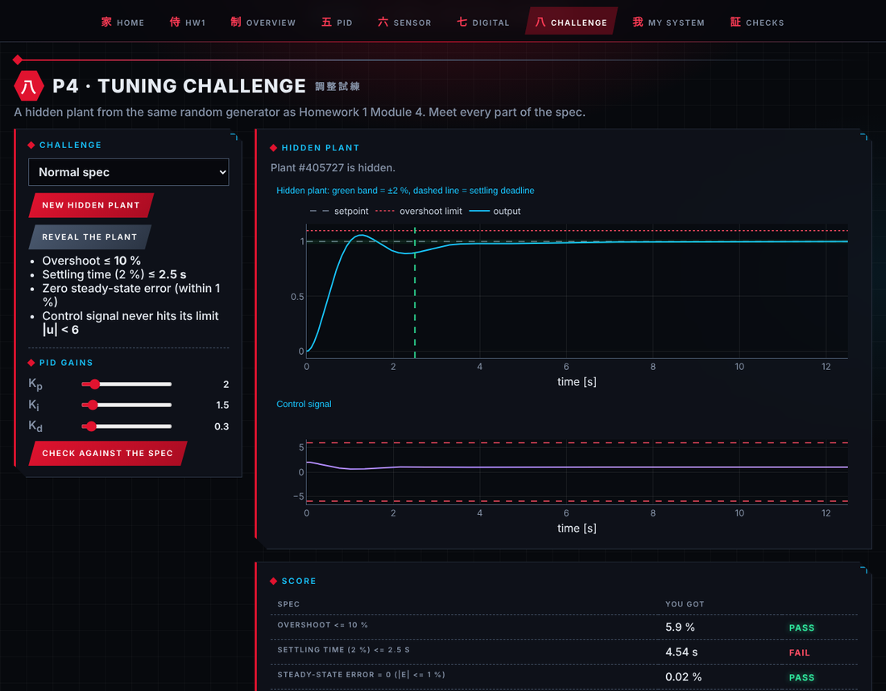
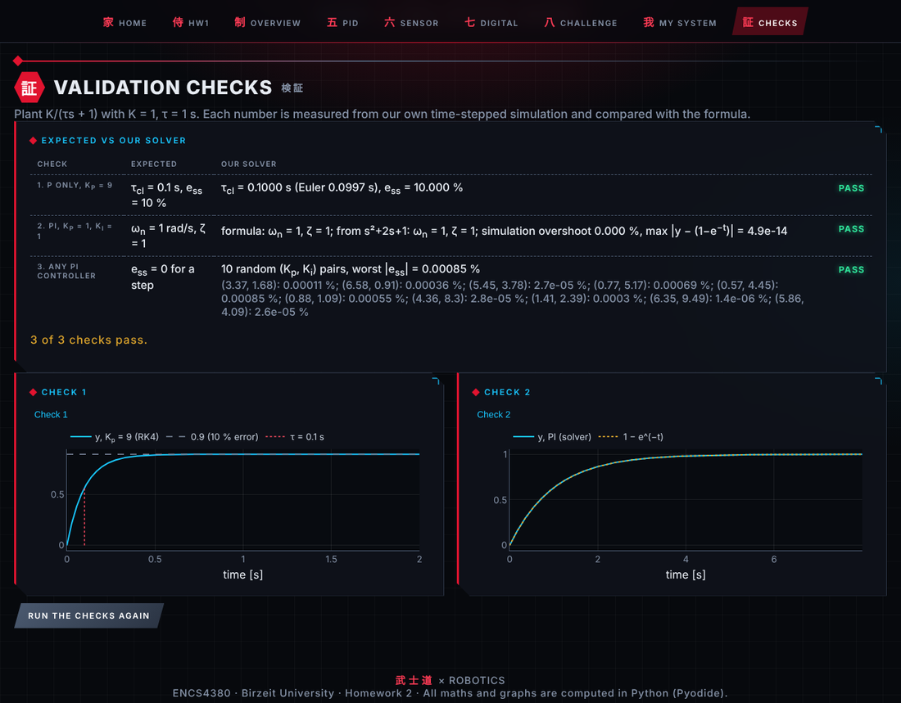

<div align="center">

# 侍 Group Messi Toolkit

### Dynamic Characteristics · PID Control

**ENCS4380 Interfacing Techniques · Birzeit University · Group Messi**<br>
Instructor: Dr. Wasel Ghanem

<br>

<a href="https://jamalowesi.github.io/encs4380-dynamics-messi/"></a>
&nbsp;
<a href="https://jamalowesi.github.io/encs4380-dynamics-messi/control/"></a>

<sub>▲ click to open the live site (runs in your browser, works on a phone)</sub>

<br>

**Homework 1**<br>
<a href="https://jamalowesi.github.io/encs4380-dynamics-messi/#m1"></a>
<a href="https://jamalowesi.github.io/encs4380-dynamics-messi/#m2"></a>
<a href="https://jamalowesi.github.io/encs4380-dynamics-messi/#m3"></a>
<a href="https://jamalowesi.github.io/encs4380-dynamics-messi/#m4"></a>

**Homework 2**<br>
<a href="https://jamalowesi.github.io/encs4380-dynamics-messi/control/#p1"></a>
<a href="https://jamalowesi.github.io/encs4380-dynamics-messi/control/#p2"></a>
<a href="https://jamalowesi.github.io/encs4380-dynamics-messi/control/#p3"></a>
<a href="https://jamalowesi.github.io/encs4380-dynamics-messi/control/#p4"></a>
<a href="https://jamalowesi.github.io/encs4380-dynamics-messi/control/#my"></a>
<a href="https://jamalowesi.github.io/encs4380-dynamics-messi/control/#val"></a>

<br>

<a href="https://github.com/JamalOwesi/encs4380-dynamics-messi/releases"></a>
<a href="https://github.com/JamalOwesi/encs4380-dynamics-messi/tree/main/tests"></a>
<a href="TESTING.md"></a>
<a href="https://pyodide.org"></a>
<a href="https://github.com/JamalOwesi/encs4380-dynamics-messi"></a>

<br>

A static site on GitHub Pages where every equation and every graph is computed in **Python running in the browser** through Pyodide.
No server, Binder or login. It works on a phone.


</div>

---

## Contents

- [Team](#team)
- [Quick links](#quick-links)
- [Homework 2 · PID Control (v2.0)](#homework-2--pid-control-v20)
  - [What's new](#whats-new-in-v20)
  - [Modules](#modules)
  - [My system: Messi's drive motor](#my-system-messis-drive-motor)
  - [How the simulation works](#how-the-simulation-works)
  - [Validation](#homework-2-validation)
  - [Bonus: Ziegler–Nichols](#bonus-zieglernichols)
- [Homework 1 · Dynamic Characteristics (v1.0)](#homework-1--dynamic-characteristics-v10)
- [Screenshots](#screenshots)
- [Run it locally](#run-it-locally)
- [Tests](#tests)
- [Files](#files)
- [Changelog](#changelog)
- [Use of AI tools](#use-of-ai-tools)

---

## Team

| Member | Student ID | Homework 1 module | Issue | Homework 2 module | Issue |
|---|---|---|---|---|---|
| Abdalfatah Dawoud | 1231540 | 一 · First-order time response | #1 | 五 · P1 PID playground | #5 |
| Jamal Owesi | 1230773 | 二 · First-order frequency response | #2 | 六 · P2 Slow sensor in the loop | #6 |
| Ahmad Abuayyash | 1230582 | 三 · Second-order response | #3 | 七 · P3 Digital PID | #7 |
| Hakam Snoubar | 1230152 | 四 · Guess the sensor | #4 | 八 · P4 Tuning challenge | #8 |
| Everyone | – | – | – | 我 My system · 証 Validation | #9 |

---

## Quick links

Every module has its own link.

| Homework 1 | | Homework 2 | |
|---|---|---|---|
| 一 First-order time | [`index.html#m1`](https://jamalowesi.github.io/encs4380-dynamics-messi/#m1) | 五 P1 PID playground | [`control/#p1`](https://jamalowesi.github.io/encs4380-dynamics-messi/control/#p1) |
| 二 Frequency response | [`index.html#m2`](https://jamalowesi.github.io/encs4380-dynamics-messi/#m2) | 六 P2 Slow sensor | [`control/#p2`](https://jamalowesi.github.io/encs4380-dynamics-messi/control/#p2) |
| 三 Second order | [`index.html#m3`](https://jamalowesi.github.io/encs4380-dynamics-messi/#m3) | 七 P3 Digital PID | [`control/#p3`](https://jamalowesi.github.io/encs4380-dynamics-messi/control/#p3) |
| 四 Guess the sensor | [`index.html#m4`](https://jamalowesi.github.io/encs4380-dynamics-messi/#m4) | 八 P4 Tuning challenge | [`control/#p4`](https://jamalowesi.github.io/encs4380-dynamics-messi/control/#p4) |
| | | 我 My system | [`control/#my`](https://jamalowesi.github.io/encs4380-dynamics-messi/control/#my) |
| | | 証 Validation | [`control/#val`](https://jamalowesi.github.io/encs4380-dynamics-messi/control/#val) |

---

## Homework 2 · PID Control (v2.0)

> Homework 1 measured how slow a system is. Homework 2 closes the loop: the controller compares what we want with what the sensor says, and drives the actuator.

$$u(t) = K_p\,e(t) + K_i\!\int e\,dt + K_d\,\frac{de}{dt}, \qquad e = r - y_m$$

### What's new in v2.0

- **Linked homeworks:** the Homework 1 page (`index.html`) has a new `制 Control` nav link and a "Next: Homework 2" card; the Control section links back to Homework 1. Homework 1's maths and styling are unchanged.
- **Control section** (`control/`) with four PID modules, a "My system" design page and a validation page.
- **Our own solver** (`control/py/pid_core.py`): the closed loop is stepped in time with **RK4** (or **Euler**, selectable in P1). We use no closed-form answers, because none exist for every gain setting, saturation or sensor.
- **Arduino code generation:** the digital PID that is simulated is exported as a ready-to-upload sketch.
- **Built on Homework 1:** the plants are Module 1's first-order and Module 3's second-order models, and P4's hidden plants come from Module 4's `generate_sensor()`.
- **One look:** the whole site uses Homework 1's `style.css`; `control/control.css` only adds the controls column, tables and plot styling.
- **Automatic tests** for both homeworks in `tests/`.

### Modules

| Module | What you can change | What the page shows |
|---|---|---|
| **五 P1 · PID playground** | Plant (first or second order), Kp, Ki, Kd, setpoint step, actuator limit, D on the error or on the measurement, solver (RK4/Euler) | Live block diagram, output vs setpoint, control signal with its limit, **rise time, overshoot, settling time, steady-state error**, time at the limit, Routh stability test, the hand formulas next to the simulation |
| **六 P2 · Slow sensor in the loop** | Sensor time constant τs, plant, PID gains | **True output and sensor reading on one plot**, overshoot of both, the Routh condition with live numbers, overshoot-vs-τs sweep with **the point where oscillation starts** marked |
| **七 P3 · Digital PID** | Sampling time Ts, gains, actuator limit, **anti-windup on/off** | **Stair-step u[k]** and the integral term, samples on the output, the continuous loop as a reference, **performance vs Ts**, a sampling-rate check, and the **Arduino code** for the current gains with a copy button |
| **八 P4 · Tuning challenge** | Kp, Ki, Kd, difficulty | A **hidden random plant** (Module 4's generator), a clear spec drawn on the plot, **pass or fail on each part**, a score out of 100, attempts and best score, a reveal button |
| **我 My system** | K and τ (or fit them from a step-test log), damping ζ, settling time, Ts | Plant model and its source, the justified spec, PI gains from the design formulas, simulated digital loop with PWM 0–100 %, pass/fail checks, the Arduino sketch |
| **証 Validation** | – | The three checks from the sheet: expected value, our solver's value, PASS/FAIL, plots |

**P4 spec** (normal difficulty): overshoot ≤ 10 %, 2 % settling time ≤ 0.6 × the plant's open-loop settling time, zero steady-state error (≤ 1 %), and the control signal never hits its limit. Easy uses 0.8× and hard 0.5×.

**Predict, then check.** Every module has a question box: pick an answer, press **Check**, and the simulator runs that exact case and explains the result. For example:

| Module | Question | What the simulator shows |
|---|---|---|
| P1 | P only: raise Kp from 1 to 9. What happens to the steady-state error? | It shrinks from 50 % to 10 % but never reaches zero |
| P1 | Second-order plant: add Kd = 0.3. Overshoot? | Drops from 56 % to 36 % |
| P2 | Sensor τs = 0.6 s: which overshoots more, the true output or the sensor? | The true output (133 %); the sensor shows only 72 % |
| P3 | The actuator saturates: switch anti-windup on. Overshoot? | Drops from 24 % to 0 % |
| P4 | On this hidden plant, double Kd. Overshoot? | Answered by simulating your own gains |

### My system: Messi's drive motor

Our course project is the **Micromouse "Messi"**. The plant is one drive motor:

- **Input:** PWM duty cycle u [%], 0–100
- **Output:** wheel speed y [rpm], from the encoder
- **Model:** $G(s) = \dfrac{K}{\tau s + 1}$

| Parameter | Value | Source |
|---|---|---|
| K | **_TODO_** rpm per % PWM | PWM step test logged with the encoder |
| τ | **_TODO_** s | Same test: time to reach 63.2 % of the final speed |

**How we measured it.** The generated sketch has a `STEP_TEST = true` switch: it applies a PWM step at t = 0.5 s and prints `t,setpoint,speed,u` every Ts. We pasted the Serial Monitor log into the page's **Fit** tool, which gives K = Δspeed / ΔPWM and τ = the time to 63.2 %.

**Spec and why it matters for a micromouse:**

| Requirement | Why |
|---|---|
| 0.6 ≤ ζ ≤ 0.8 | If one wheel overshoots its speed and the other doesn't, the mouse yaws at every speed change and drifts towards a wall. |
| Settling time ≤ **_TODO_** s | The wheels must follow the speed profile well within one cell-to-cell move. |
| PWM stays inside 0–100 % | A saturated wheel runs open loop, the two wheels stop matching, and the integrator winds up. |
| Zero steady-state error | Both wheels hold the same speed on long straights. |

**Design (PI by pole placement on a first-order plant):**

$$\omega_n = \frac{4}{\zeta\,t_s}, \qquad K_i = \frac{\omega_n^2\,\tau}{K}, \qquad K_p = \frac{2\zeta\omega_n\tau - 1}{K}$$

| Final design | Kp = **_TODO_** | Ki = **_TODO_** | Ts = **_TODO_** ms |
|---|---|---|---|

The simulated response and the full Arduino sketch (encoder interrupt, fixed-rate loop, anti-windup) are on the [My system page](https://jamalowesi.github.io/encs4380-dynamics-messi/control/#my).

### How the simulation works

**Continuous loop (P1, P2, P4).** The whole closed loop is **one state vector**, stepped with **RK4** (default) or **Euler**:

| State | Equation |
|---|---|
| Plant, first order | $\dot y = (K u - y)/\tau$ |
| Plant, second order | $\ddot y = \omega_n^2 (K u - y) - 2\zeta\omega_n \dot y$ |
| Sensor (P2) | $\dot y_m = (y - y_m)/\tau_s$ |
| Integral | $\dot I = e$, frozen while saturated if anti-windup is on |
| Derivative | $K_d \dfrac{s}{T_f s + 1}$, with $T_f$ = 5 time steps |

At every step: $e = r - y_m$, $u = K_p e + K_i I + D$, then **u is clipped to the actuator limit**. "D on the measurement" differentiates $-y_m$ instead of $e$: the same damping, but no spike (derivative kick) when r jumps.

**Digital loop (P3, My system).** The sheet's formula, computed once per sample and **held** until the next one (zero-order hold), while the plant keeps evolving on a finer RK4 grid:

$$u[k] = K_p e[k] + K_i T_s \sum_{j=0}^{k} e[j] + K_d \frac{e[k] - e[k-1]}{T_s}$$

**Anti-windup (clamping):** if u is saturated **and** the error would push it further into the limit, the new error is not added to the sum. The generated Arduino `pidUpdate()` is this same algorithm, line for line.

**Metrics:**

| Metric | Definition |
|---|---|
| Rise time | 10 % → 90 % of the final value |
| Overshoot | (peak − final) / final × 100 % |
| Settling time | Last time the output leaves a ±2 % band around the final value |
| Steady-state error | r − final value |

If the response hasn't settled inside the time window, the page says so instead of showing a misleading number.

**Stability tools.** Routh–Hurwitz on the closed-loop characteristic polynomial, shown live in P1 and P2. For a first-order plant with PID and a sensor it reduces to $(\tau + \tau_s + K K_d)(1 + K K_p) > \tau\,\tau_s\,K K_i$.

### Homework 2 validation

Plant $K/(\tau s + 1)$ with K = 1, τ = 1 s. Every number comes from our time-stepped solver, not from the formulas.

| # | Check | Expected | Our solver | |
|---|---|---|---|---|
| 1 | P only, Kp = 9 | τcl = 0.1 s, ess = 10 % | τcl = **0.1000 s**, ess = **10.000 %** (Euler agrees) | ✅ |
| 2 | PI, Kp = Ki = 1 | ωn = 1 rad/s, ζ = 1 | ωn = **1**, ζ = **1** from s² + 2s + 1; 0 % overshoot; y(t) matches 1 − e⁻ᵗ to **5 × 10⁻¹⁴** | ✅ |
| 3 | Any PI controller | ess = 0 | 10 random (Kp, Ki) pairs, worst \|ess\| = **0.0008 %** | ✅ |

### Bonus: Ziegler–Nichols

In **P2 → Bonus**, the page finds the P-only gain $K_u$ where the loop (plant + sensor) starts to oscillate, and its period $T_u$, from the frequency where the loop phase reaches −180°. It then applies the classic rules:

| Controller | Kp | Ti | Td |
|---|---|---|---|
| P | 0.5 Ku | – | – |
| PI | 0.45 Ku | Tu / 1.2 | – |
| PID | 0.6 Ku | Tu / 2 | Tu / 8 |

with Ki = Kp/Ti and Kd = Kp·Td. "Use" buttons load the gains, and "Show the loop at K = Ku" shows the sustained oscillation.
Example: second-order plant (ωn = 2, ζ = 0.5) with τs = 0.2 s gives **Ku ≈ 3.9 and Tu ≈ 1.68 s**.

---

## Homework 1 · Dynamic Characteristics (v1.0)

> A sensor never reports the present: it reports the past, smoothed. Four modules on one page, [`index.html`](https://jamalowesi.github.io/encs4380-dynamics-messi/).

### 一 · First-order time response
- ✅ Sliders for K and τ, and a step / ramp input switch
- ✅ 63.2 % marker at t = τ and 95 % marker at t = 3τ
- ✅ Ramp lag = τ and the steady-state error
- ✅ Error-fraction plot on a log axis with slope −1/τ
- ✅ "Predict, then check" box

### 二 · First-order frequency response
- ✅ Sliders for τ and input frequency
- ✅ Input and output sines on one plot
- ✅ Amplitude ratio and phase lag shown
- ✅ Bode plot with the cutoff at ω = 1/τ
- ✅ Dynamic-error calculator (δ = M − 1)
- ✅ "Predict, then check" box

### 三 · Second-order response
- ✅ Sliders for ζ and ωn (or m, b, k)
- ✅ Underdamped, critically damped and overdamped steps
- ✅ Rise time, peak time, overshoot and settling time read live off the curve
- ✅ Poles in the s-plane
- ✅ State-space panel: A and B update live, eigenvalues next to the poles, phase-plane path
- ✅ "Predict, then check" box

### 四 · Guess the sensor
- ✅ Hidden random sensor: first order (K, τ) or second order (ζ, ωn), with noise
- ✅ Step response, or a sine for first order
- ✅ Estimates entered first; nothing is revealed before the guess
- ✅ Reveal of the true values, with the true curve over the guess
- ✅ Score: within 10 % is full marks
- ✅ "New sensor" button, running session score, and a hint on request

### Homework 1 validation

| # | Check | Expected | |
|---|---|---|---|
| 1 | First-order step | y(τ) = 0.632 KA, y(3τ) = 0.95 KA | ✅ |
| 2 | τ = 0.2 s, input sin 2t | M = 0.93, φ = 21.8° | ✅ |
| 3 | 100 Hz within 5 % | τmax ≈ 0.52 ms, φ = 9.3° at 50 Hz | ✅ |
| 4 | ζ = 0.5 | 16.3 % overshoot | ✅ |
| 5 | ζ = 1 | No overshoot | ✅ |
| 6 | m = 1, b = 2, k = 4 | Eigenvalues −1 ± j1.732 = poles | ✅ |

---

## Screenshots

### Homework 2

**五 P1 · PID playground**



**六 P2 · A slow sensor in the loop** (τs = 0.6 s: the true output overshoots 133 %, the sensor shows 72 %)



**七 P3 · Digital PID** (anti-windup on)



**八 P4 · Tuning challenge** (pass/fail per part of the spec)



**証 Validation checks** (3 of 3 pass)



<!-- TODO: after the real step test, add docs/screenshots/my.png (My system page) here. -->

### Homework 1

**一 Module 1 · First-order time response**


**二 Module 2 · First-order frequency response**


**三 Module 3 · Second-order response**


**四 Module 4 · Guess the sensor**


---

## Run it locally

The pages fetch their `.py` files, which browsers block for pages opened from disk, so **double-clicking `index.html` will not work**. Start a small server in the repo folder instead:

```bash
git clone https://github.com/JamalOwesi/encs4380-dynamics-messi.git
cd encs4380-dynamics-messi
python -m http.server 8000
```

Then open **http://localhost:8000/**. The first load needs internet (Pyodide and Plotly come from CDNs) and takes 5–15 s.
To test on a phone on the same Wi-Fi, run `python -m http.server 8000 --bind 0.0.0.0` and open `http://<your-laptop-IP>:8000/`.

---

## Tests

```bash
python tests/test_hw1_modules.py   # Homework 1: validation checks 1–6, cutoff, log slope, Module 4 scoring
python tests/test_pid_core.py      # Homework 2: PID checks 1–3, Routh, slow sensor, digital PID, anti-windup, P4
python -m pytest tests/ -q         # or both at once
```

The maths runs in plain Python too, because each module imports `js` only inside its browser start-up function.
[`TESTING.md`](TESTING.md) lists, for every module, what to click and the exact numbers you should see.

---

## Files

```
index.html               Landing page = Homework 1 (all four modules), links to the Control section
style.css                Shared theme (robotics + samurai), used by every page
module1.py               一 First-order time response
module2.py               二 First-order frequency response
module3.py               三 Second-order response and state space
module4.py               四 Guess the sensor (its generator also feeds P4)
control/
  index.html             Homework 2 page: tabs, block diagrams, Pyodide loader
  control.css            Control-only layout on top of ../style.css
  py/
    pid_core.py          The solver: plants, RK4/Euler loop, digital PID, metrics,
                         Routh, ultimate gain, PI design, step-test fit, P4 grading
    ui.py                Sliders, Plotly wrapper, "Predict, then check" box
    arduino_code.py      Generates the Arduino sketch from the current gains
    p1_playground.py     五 P1      p2_sensor.py     六 P2
    p3_digital.py        七 P3      p4_challenge.py  八 P4
    my_system.py         我 My system
    validation.py        証 Validation
    main.py              Starts every module, draws a tab when it opens
tests/
  test_hw1_modules.py    Homework 1 tests
  test_pid_core.py       Homework 2 tests
docs/screenshots/        Images used in this README
TESTING.md               How to run and test each module by hand
```

**How the two homeworks are linked.**

| From | Link | Goes to |
|---|---|---|
| Homework 1 page (`index.html`) | nav `制 Control` and the "Next: Homework 2" card | `control/` |
| Control section (`control/index.html`) | nav `家 Home` | `../index.html` |
| Control section (`control/index.html`) | nav `侍 HW1` | `../index.html#m1` |
| P4 (`control/py/p4_challenge.py`) | loads `../module4.py` | Module 4's `generate_sensor()` |

**How the pages work.** `index.html` loads Pyodide, fetches the four `.py` files and starts each module; each module's HTML section holds the element IDs its Python file looks for. `control/index.html` does the same with `control/py/*.py` and `../module4.py`. The tab is in the address (`control/#p3`), so every module has its own link.

**Tech.** HTML and CSS · Python 3 in the browser via [Pyodide](https://pyodide.org) · Homework 1 draws its charts as SVG generated in Python · Homework 2 plots with [Plotly.js](https://plotly.com/javascript/) · GitHub Pages.

---

## Changelog

### v2.0 · Homework 2 (23 Nov 2026)

- **Added** the Control section `control/`: P1 PID playground, P2 slow sensor, P3 digital PID, P4 tuning challenge, My system, Validation.
- **Added** our own closed-loop solver `control/py/pid_core.py` (RK4/Euler), the Arduino code generator, and the tests in `tests/`.
- **Linked** the two homeworks:
  - `index.html` (Homework 1): added the `制 Control` nav link and a "Next: Homework 2 · Control" card above the footer.
  - `control/index.html`: the `侍 HW1` nav link points to `../index.html#m1`. It used to point to `dynamics.html`, which doesn't exist, and gave a **404**.
- **Reused** Module 4: P4's hidden plants come from `module4.generate_sensor()`.
- **Updated** this README: Homework 2 section, team table with both homeworks, validation results, screenshots, run/test instructions, AI use for both homeworks. Fixed the live-site link (it pointed to `localhost`).
- **Added** `TESTING.md` (how to run and test each module) and `docs/screenshots/`.
- **Unchanged:** `module1.py` … `module4.py` and `style.css`.

### v1.0 · Homework 1 (12 Nov 2026)

- Four modules on one page: first-order time response, frequency response, second-order response, guess the sensor. Validation checks 1–6 pass.

---

## Use of AI tools

AI coding assistants were used in both homeworks, as the assignments allow. In the demo, every member can explain any line of their own module and any equation on the page.

### Homework 1

- **Exploring Python libraries for the browser.** We used AI to learn how Pyodide lets Python run inside a web page, how `from js import document` connects Python to the page, and how to draw our charts as SVG generated by Python, with no NumPy, Matplotlib or other charting library.
- **Clearing up ambiguous points.** AI helped us understand parts of the homework and the lecture material that were unclear, such as how the error-fraction plot on a log axis gives slope −1/τ, how to read overshoot and peak time off a second-order curve, and how the state-space eigenvalues match the poles.
- **A smooth, good-looking frontend.** AI helped us design the HTML and CSS: a dark robotics-style interface with a samurai touch (Japanese kanji headings, a crimson seal, angled panels, glowing curves). It also helped with the card layout, the sticky menu, and making the page work on a phone.

| Member | Module | How AI was used |
|---|---|---|
| Abdalfatah Dawoud | 1 · First-order time response | Learning how Pyodide connects Python to the page, understanding the step, ramp and log-error plots, and styling the page |
| Jamal Owesi | 2 · First-order frequency response | Understanding amplitude ratio, phase lag and the Bode plot, drawing the plots with Python-generated SVG, and styling the page |
| Ahmad Abuayyash | 3 · Second-order response | Understanding damping cases, rise, peak and settling time, the poles and state-space panel, and styling the page |
| Hakam Snoubar | 4 · Guess the sensor | Understanding how to estimate τ, ζ and ωn from a noisy curve, the scoring and reveal, and styling the page |

### Homework 2

<!-- TODO: check every line below and edit it so it matches what each member actually did. -->

- **The closed-loop solver.** We used Claude (Anthropic) to help write `pid_core.py`: the state-vector loop stepped with RK4/Euler, the digital PID with anti-windup, the step-response metrics and the Routh test. We checked it against the three validation numbers and the tests in `tests/`.
- **Understanding PID behaviour.** AI helped us understand questions that came up while testing, for example why adding Kd *raises* the overshoot on a first-order plant with PI (Kd adds to the time constant, τ + K·Kd, which lowers ζ), while it damps a second-order plant.
- **Arduino code and the frontend.** AI helped write the Arduino code generator and restyle the Control section to match Homework 1's theme, and link the two homeworks together.

| Member | Module | How AI was used |
|---|---|---|
| Abdalfatah Dawoud | P1 · PID playground | Understanding how each gain changes the four metrics, the Kp/Kd interaction, and wiring the sliders to the solver |
| Jamal Owesi | P2 · Slow sensor | Understanding why a slow sensor causes oscillation, the Routh condition, and the Ziegler–Nichols bonus |
| Ahmad Abuayyash | P3 · Digital PID | Understanding sampling time, the zero-order hold and windup, and generating the Arduino code |
| Hakam Snoubar | P4 · Tuning challenge | Reusing Module 4's generator for hidden plants, designing a fair spec, and the pass/fail scoring |

---

<div align="center">

**武士道 × ROBOTICS** · ENCS4380 · Birzeit University · Group Messi

`v1.0` Homework 1 · `v2.0` Homework 2

</div>
