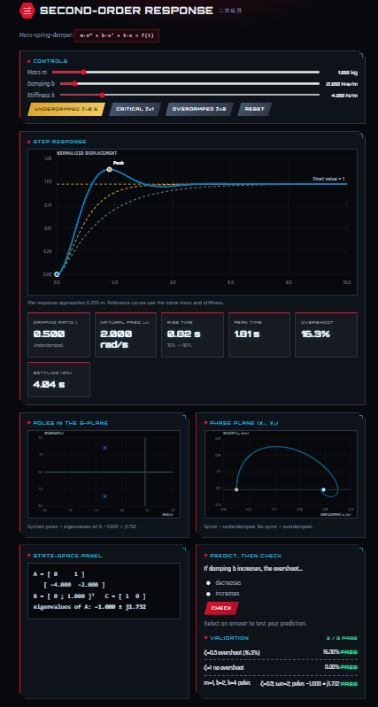

# Dynamic Characteristics Interactive Toolkit

**ENCS4380 Interfacing Techniques · Birzeit University · Homework 1 · Group Messi**
Instructor: Dr. Wasel Ghanem

**Live site:** http://localhost:8000/  

A static site (GitHub Pages) where all maths and graphs are computed in Python running in the browser through Pyodide. No server, Binder or login is needed.

## Team

| Member | Student ID | Module | GitHub Issue |
|---|---|---|---|
| Abdalfatah Dawoud | 1231540| 1 · First-order time response | #1 |
| Jamal Owesi | 1230773 | 2 · First-order frequency response | #2 |
| Ahmad Abuayyash | 1230582 | 3 · Second-order response | #3 |
| Hakam Snoubar | 1230152 | 4 · Guess the sensor | #4 |

## Files

| File | Purpose |
|---|---|
| `index.html` | The whole site: all four modules on one page |
| `style.css` | Styling (robotics + samurai theme) |
| `module1.py` | Module 1 · first-order time response (Python) |
| `module2.py` | Module 2 · first-order frequency response (Python) |
| `module3.py` | Module 3 · second-order response and state space (Python) |
| `module4.py` | Module 4 · Guess the sensor (Python) |

`index.html` loads Pyodide, fetches the four `.py` files and starts each module. Each module's section in `index.html` has the element IDs its Python file looks for, so a module's HTML section and its `.py` file belong together.

## Module checklist (from the assignment)

### Module 1 · First-order time response
- [ ] Sliders for K and τ, and a step / ramp input switch
- [ ] 63.2% marker at t = τ and 95% marker at t = 3τ
- [ ] Ramp lag = τ and the steady-state error
- [ ] Error-fraction plot on a log axis with slope −1/τ
- [ ] "Predict, then check" box
- [ ] Validation 1: y(τ) = 0.632 KA and y(3τ) = 0.95 KA (expected, yours, pass/fail)

### Module 2 · First-order frequency response
- [ ] Sliders for τ and input frequency
- [ ] Input and output sines on one plot
- [ ] Amplitude ratio and phase lag shown
- [ ] Bode plot with the cutoff at ω = 1/τ
- [ ] Dynamic-error calculator (δ = M − 1)
- [ ] "Predict, then check" box
- [ ] Validation 2: τ = 0.2 s, sin 2t gives 0.93 and 21.8°
- [ ] Validation 3: 100 Hz at 5% gives τmax ≈ 0.52 ms and 9.3° at 50 Hz

### Module 3 · Second-order response
- [ ] Sliders for ζ and ωn (or m, b, k)
- [ ] Underdamped, critically damped and overdamped steps
- [ ] Rise time, peak time, overshoot and settling time read live off the curve
- [ ] Poles in the s-plane
- [ ] State-space panel: A and B update live, eigenvalues next to the poles, phase-plane path
- [ ] "Predict, then check" box
- [ ] Validation 4: ζ = 0.5 gives 16.3% overshoot
- [ ] Validation 5: ζ = 1 gives no overshoot
- [ ] Validation 6: m = 1, b = 2, k = 4 gives eigenvalues −1 ± j1.732 equal to the poles

### Module 4 · Guess the sensor
- [ ] Hidden random sensor: first order (K, τ) or second order (ζ, ωn), with noise
- [ ] Step response, or a sine for first order
- [ ] User enters estimates; nothing is revealed before the guess
- [ ] Reveal of true values, overlay of the true curve on the guess
- [ ] Score: within 10% is full marks
- [ ] "New sensor" button and a running session score
- [ ] Hint on request

## Run locally

```
python -m http.server
```

Open `http://localhost:8000`. Opening the HTML by double-click will not work, because the page fetches the `.py` files.

## Screenshots
**Module 1 · First-order time response**


**Module 2 · First-order frequency response**


**Module 3 · Second-order response** 




## Use of AI tools


