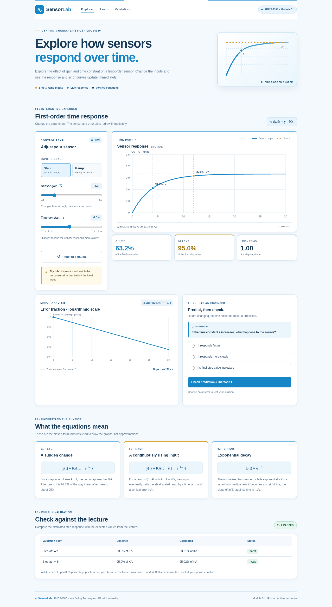

# SensorLab — Dynamic Characteristics Toolkit

**Group: Messi**

**Group members:** Ahmad AbuAyyash · Jamal Owesi · Hakam Snouber · Abd-Alfattah Dawood

**ENCS4380 Interfacing Techniques · Birzeit University · Homework 1**

## Checkpoint 1 (3 November 2026)

A responsive, entirely client-side first-order dynamic characteristics teaching tool with a simple Argentina-inspired sky blue, white, and gold academic interface. The module includes:

- Live gain **K** and time-constant **τ** sliders.
- Switchable **unit step** and **unit-slope ramp** inputs.
- Time-response curve over a fixed 0–30 s window, ideal input comparison, and the step response **63.2% at τ** and **95.0% at 3τ** markers.
- Ramp steady-state time lag **τ**, vertical error **KAτ**, and finite-time error.
- A logarithmic **transient error-fraction** graph with slope **−1/τ** for ln(error fraction) versus time.
- **Predict, then check** exercise that changes τ and provides feedback.
- Live validation against the first two rounded lecture values of validation test 1.
- Mobile-friendly layout and no external JavaScript dependencies.

## Design notes

The interface uses the Argentina national football team’s **sky blue and white**, with a small gold accent, while keeping charts and course concepts central. The public website does not display assignment instructions or submission requirements; those stay in this README.

### Live GitHub Pages link

https://jamalowesi.github.io/encs4380-dynamics-messi/

## Screenshot

## Launch locally

Open `index.html` in a modern browser. No server, npm, or installation is needed.

## GitHub Pages deployment

1. Create a **public** repository named `encs4380-dynamics-messi`.
2. Upload **all** project files and folders (`index.html`, `assets`, `README.md`, `.nojekyll`) to the repository root on the `main` branch.
3. Open **Settings → Pages → Build and deployment → Source: Deploy from a branch**.
4. Choose **Branch: main** and **Folder: /(root)** and click **Save**.
5. Open the live URL shown in **Settings → Pages** and test step/ramp graphs and the sliders on a phone.
6. Add the live link to this README and commit the change.

## Group collaboration and module ownership

**Group name:** Messi

| Group member | Assigned module / contribution | GitHub issue |
|---|---|---|
| Ahmad AbuAyyash | To be assigned by the group | — |
| Jamal Owesi | To be assigned by the group | — |
| Hakam Snouber | To be assigned by the group | — |
| Abd-Alfattah Dawood | To be assigned by the group | — |

Each group member should make commits for their own contribution. Create a GitHub issue for each of the four modules and assign an owner. Invite the instructor to the repository using `ghanem@staff.birzeit.edu` via **Settings → Collaborators → Add people**.

## Equations implemented

System: `τ y'(t) + y(t) = K x(t)`; initial condition `y(0) = 0`.

With a **unit step** `x(t) = A = 1`:

`y(t) = KA[1 - exp(-t/τ)]`

With a **unit ramp** `x(t) = At` and `A = 1 unit/s`:

`y(t) = KA[t - τ(1 - exp(-t/τ))]`

Ramp scaled-input error:

`Kx(t) - y(t) = KAτ[1 - exp(-t/τ)]`, tending to `KAτ` as `t → ∞`.

The normalized transient error fraction is `E(t) = exp(-t/τ)`. For steps it is `(KA - y)/(KA)`. For ramps it is `(KAτ - [Kx-y])/(KAτ)`. Hence `ln E(t) = -t/τ`, slope `-1/τ`.

Expected check 1: `y(τ)/(KA) = 1 - exp(-1) = 63.212%` → `63.2%` rounded.

Expected check 2: `y(3τ)/(KA) = 1 - exp(-3) = 95.021%` → `95.0%` rounded.

## Course timeline

- **Nov 3:** Checkpoint 1 — GitHub Pages live + Module 1 working.
- **Nov 9:** Checkpoint 2 — Modules 2 & 3 working.
- **Nov 12:** Final — all four modules, release tag `v1.0` and course-page link.
- **Nov 15–16:** Group demonstration and individual explanation.

## AI-use disclosure

The initial HTML, CSS, JavaScript, and documentation were created **with assistance from ChatGPT**. Group members are responsible for understanding, testing, modifying, and explaining every equation and line of code in the demo. Adjust this note if your actual workflow differs.
